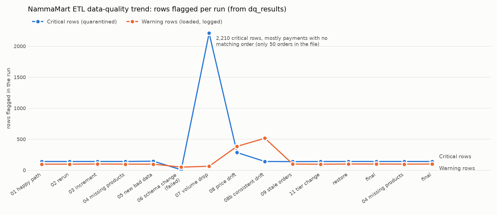

# NammaMart Quick Commerce: ETL & ELT Pipelines

**FDAIE Module 2 · Data Engineering Foundations**
Submitted by **Athresh Shigaval** · DAGs `nammamart_etl_athresh`, `nammamart_elt_athresh` · warehouse `include/warehouse_athresh.duckdb`

---

## Contents

0. [At a glance](#0-at-a-glance)
1. [Part 0: Discovery and data profiling](#part-0-discovery-and-data-profiling)
2. [Part A: ETL pipeline](#part-a-etl-pipeline)
3. [Part B: ELT pipeline](#part-b-elt-pipeline)
4. [Part C: Scheduling](#part-c-scheduling-0900-ist-mondaysaturday)
5. [Part D: Data quality dimensions](#part-d-data-quality-dimensions)
6. [Business questions (both pipelines)](#business-questions-both-pipelines)
7. [Part E: Data governance](#part-e-data-governance)
8. [Part F: Observability tests](#part-f-observability-tests)
9. [Part G: Recommendation to the client](#part-g-recommendation-to-sameer-cto)
10. [Acceptance criteria, screenshots, bonus items](#acceptance-criteria-screenshots-and-bonus)

---

## 0. At a glance

| | ETL (`nammamart_etl_athresh`) | ELT (`nammamart_elt_athresh`) |
|---|---|---|
| Flow | Extract (6 parallel) → Validate (Python) → Quarantine → Transform (pandas) → Load star schema → Reconcile → Report → Audit | Load raw (6 parallel, text, no cleaning) → Staging SQL (types, rules, masking, MERGE) → Marts SQL → DQ / quarantine → Audit |
| Reporting tables | `etl_fact_orders`, `etl_dim_customer`, `etl_dim_product`, `etl_dim_store`, `etl_payment_reconciliation`, `etl_daily_zone_revenue`, `etl_category_margin` | `mart_fact_orders` (view), `mart_daily_store_kpis`, `mart_category_margin`, `mart_delivery_sla`, `mart_payment_reconciliation`, `mart_payment_mode_summary`, `mart_top_customers`, `dim_customer_scd2` |
| Bad rows | never enter the warehouse; CSV per file in `include/quarantine/athresh/` + `etl_quarantine` | kept in `raw_*`, flagged `dq_status='FAIL'` in staging, copied to `elt_quarantine` |
| Schedule | `0 9 * * 1-6`, Asia/Kolkata (03:30 UTC) | same |
| Shared | `dq_check_registry` (69 checks), `dq_results`, `pipeline_runs`, failure alert via Airflow Variable `SLACK_WEBHOOK_URL` | same |

**Result:** both pipelines publish the same September numbers to the paisa: **₹11,31,435.10 net revenue, ₹2,59,638.93 gross margin, 2,078 delivered orders**, with **0 differing order rows and 0 differing reconciliation rows** ([`include/nammamart/compare_pipelines.py`](include/nammamart/compare_pipelines.py)).

**Repository map**

| Path | What it is |
|---|---|
| [`dags/nammamart_etl_athresh.py`](dags/nammamart_etl_athresh.py) | ETL DAG (TaskFlow) |
| [`dags/nammamart_elt_athresh.py`](dags/nammamart_elt_athresh.py) | ELT DAG (TaskFlow, one task per SQL file) |
| [`include/nammamart/config.py`](include/nammamart/config.py) | paths, file contracts, business rules and thresholds (one place) |
| [`include/nammamart/dq_registry.py`](include/nammamart/dq_registry.py) | the 69 data-quality checks: name, dimension, severity, level |
| [`include/nammamart/etl_checks.py`](include/nammamart/etl_checks.py) | the checks in pandas (ETL) |
| [`include/nammamart/etl_transform.py`](include/nammamart/etl_transform.py) | ETL transform, idempotent MERGE load, reconciliation, reports |
| [`include/nammamart/masking.py`](include/nammamart/masking.py) | PII masking (ETL); SQL twin in `00_setup.sql` |
| [`include/nammamart/warehouse.py`](include/nammamart/warehouse.py) | lock-safe DuckDB connection, `dq_results` / `pipeline_runs` writers |
| [`include/nammamart/observability.py`](include/nammamart/observability.py) | failure alert callback, run audit |
| [`include/nammamart/elt_runner.py`](include/nammamart/elt_runner.py) | raw loader (DuckDB native CSV reader) and SQL-file runner |
| [`include/sql/elt/`](include/sql/elt/) | every ELT transformation, one `.sql` per staging / mart table |
| [`include/sql/business_questions.sql`](include/sql/business_questions.sql) | the six business questions, ETL and ELT versions |
| [`include/sql/evidence_queries.sql`](include/sql/evidence_queries.sql) | audit, lineage, PII and observability evidence queries |
| [`include/nammamart/profile_data.py`](include/nammamart/profile_data.py) | Part 0 profiling script |
| [`include/nammamart/make_experiment_data.py`](include/nammamart/make_experiment_data.py) | builds the Part F test files as copies (originals never edited) |
| [`tools/`](tools/) | experiment driver, business-question runner, DQ trend chart, lock stress test |
| [`tests/nammamart/test_rules_parity.py`](tests/nammamart/test_rules_parity.py) | pins the pandas and SQL rule implementations together: same rows rejected for the same reasons, same masking, same counts |
| [`docs/evidence/`](docs/evidence/) | generated outputs: query results, experiment log, chart |
| [`docker-compose.override.yml`](docker-compose.override.yml) | fix for the Astro CLI mount bug on paths containing `&` (see §10) |

**How to run**

```bash
astro dev start                                   # Airflow UI http://localhost:8080
astro dev run dags list-import-errors             # both DAGs parse with no errors
astro dev run dags test nammamart_etl_athresh     # or trigger from the UI
astro dev run dags test nammamart_elt_athresh
python include/nammamart/compare_pipelines.py      # ETL vs ELT parity
python tools/business_questions.py                 # -> docs/evidence/business_questions.md
```

Both DAGs take two params: `data_dir` (defaults to `include/data/nammamart`; experiments point it at a copy) and `apply_increments` (default `true`: also load every `orders_<date>_increment.csv` in that folder).

---

## Part 0: Discovery and data profiling

Profiled with [`include/nammamart/profile_data.py`](include/nammamart/profile_data.py) before any pipeline code: every file read as raw text, nulls per column, duplicate keys, min/max of numeric and date columns, distinct values of category columns, referential integrity on all four relationships, and every business rule.

### Profile summary

| File | Rows | Nulls / blanks | Duplicate keys | Ranges and odd values |
|---|---|---|---|---|
| orders.csv | 2,412 | customer_id 18, order_ts 1 (+1 `N/A`), delivery_minutes 164 (156 are CANCELLED) | 12 order_ids twice (exact copies) | quantity −3..5, discount 0..**250**, order_amount −1,593..9,576, delivery 8..**1,440** min, order_ts up to **2027-01-01**; status has `delivered`, `Pending??`; payment_mode has `upi`, `UPI␠`, `CARD`, `cod`, `Cashh` |
| payments.csv | 2,228 | gateway_ref 301 (all Cash on Delivery: expected) | 4 payment_ids twice (exact copies) | amount_paid −1,593..9,576, payment_ts up to 2027-01-01, same payment_mode variants |
| customers.csv | 405 | city 6 | 5 customer_ids twice with different phone / area | email `N/A` ×4 and 8 malformed, phone 7–9 digits ×7, pincode `5600XX` ×3, signup_date up to 2027-01-05, loyalty_tier in 3 casings |
| products.csv | 152 | category 3 | P0030, P0140 twice (second copy labelled "(old)") | mrp −203..883, cost_price > mrp ×5 |
| stores.csv | 15 | zone 1 (S07) | none | capacity_orders_per_day 0 for S12 |
| orders_2026-10-01_increment.csv | 160 | none | none | 150 new orders (1 Oct) + 10 existing orders whose only change is DELIVERED → RETURNED |

Referential integrity: 18 orders with no customer, 9 orders with unknown product (`P9xxx`), 5 with unknown store (`S99`, `S17`, `S00`), 8 payments for orders that do not exist (`ORD9xxxxx`: probably gateway test transactions), 27 DELIVERED orders with no payment, 44 DELIVERED orders whose only payment FAILED. No CANCELLED order has a payment, and no payment is timestamped before its order.

### Data Issues Log

Severity: **Critical** = row quarantined; **Warning** = row loads, issue recorded in `dq_warnings` and `dq_results`.

| # | File | Row key(s) | Column | Problem | Dimension | Rule implemented | Severity |
|---|---|---|---|---|---|---|---|
| 1 | orders | ORD000539, ORD000783, ORD001110, ORD001239, ORD001326, ORD001434, ORD001441, ORD001462, ORD001549, ORD001692, ORD001870, ORD002129 | order_id | 12 orders appear twice (identical rows): would double-count revenue | Uniqueness | `orders_order_id_unique`: keep the first line, quarantine the copy | Critical |
| 2 | orders | ORD002255, ORD000701, ORD000997, … (18 rows) | customer_id | blank customer | Completeness | `orders_customer_id_not_null` | Critical |
| 3 | orders | ORD000362 (blank), ORD000403 (`N/A`) | order_ts | no timestamp | Completeness | `orders_order_ts_not_null` (placeholder tokens `N/A`, `null`, `-` treated as missing) | Critical |
| 4 | orders | ORD001610, ORD000534 (`2026-13-05`), ORD002012, ORD000946 (`31/09/2026 10:00`) | order_ts | month 13 / 31 September / wrong format | Validity | `orders_order_ts_format` (strict `YYYY-MM-DD HH:MM:SS`) | Critical |
| 5 | orders | ORD002119, ORD001765, ORD001725 (2027-01-01), ORD001121, ORD001965 (2026-11-02), ORD001693, ORD001089 (2026-10-21) | order_ts | dated after the export's business date | Timeliness | `orders_ts_not_future` | Critical |
| 6 | orders | ORD000500, ORD001970, ORD001637 | order_status | `Pending??` is not an allowed status | Validity | `orders_status_valid` | Critical |
| 7 | orders | ORD001066, ORD000153 | order_status | `delivered` lower case | Consistency | standardised to `DELIVERED`, `orders_status_casing` | Warning |
| 8 | orders | ORD000159, ORD000433, ORD000934, ORD000691 (`upi`), ORD002356, ORD001874 (`UPI␠`), ORD001364 (`CARD`), ORD001640 (`cod`), ORD001812, ORD001414 (`Cashh`) | payment_mode | non-canonical spelling | Consistency | mapped to UPI / Card / Cash on Delivery, `orders_payment_mode_casing` | Warning |
| 9 | orders | ORD002103 (250 %), ORD001237 (150 %), ORD001468 (120 %) | discount_pct | discount above 100 % | Validity | `orders_discount_range` (0–100) | Critical |
| 10 | orders | ORD000469, ORD002360, ORD001724, ORD000099 (0); ORD001296, ORD001459, ORD000867, ORD000462, ORD001124, ORD001384 (negative) | quantity | zero / negative quantity with matching negative amount | Accuracy | `orders_quantity_positive` | Critical |
| 11 | orders | ×10: ORD002305, ORD002004, ORD000845, ORD000964, ORD002031, ORD001624; ×1.5: ORD000801, ORD000880, ORD000677, ORD002128, ORD002244; ×0.5: ORD002298, ORD001274, ORD002223, ORD001755 | order_amount | amount is exactly 10×, 1.5× or 0.5× the formula: a systematic multiplier bug | Accuracy | `orders_amount_formula` (qty × price × (1 − disc/100), ±₹0.01) | Critical |
| 12 | orders | ORD001554, ORD001800, ORD000731, ORD001277, ORD000326, ORD001515, ORD002229, ORD000878 | delivery_minutes | DELIVERED but no delivery time | Completeness | `orders_delivered_has_minutes` | Critical |
| 13 | orders | ORD001037, ORD002101, ORD000424 (480), ORD001104, ORD000020 (900), ORD000455 (1,440) | delivery_minutes | 8 h / 15 h / 24 h: hours or a day recorded as minutes | Accuracy | `orders_delivery_under_max` (1–120) | Critical |
| 14 | orders | ORD000986, ORD001058, ORD001685, ORD000070, ORD000789, ORD000596, ORD000134, ORD000965, ORD002179 | product_id | `P9xxx` not in the catalogue | Consistency | `orders_product_fk` | Critical |
| 15 | orders | ORD001799 (S99), ORD001046, ORD001492, ORD001275 (S17), ORD002126 (S00) | store_id | store not in store master | Consistency | `orders_store_fk` | Critical |
| 16 | orders | 11 orders of P0109 (e.g. ORD001295, ORD000331) | unit_price | unit_price 203 > mrp −203 (caused by issue 24) | Accuracy | `orders_unit_price_within_mrp` | Warning |
| 17 | payments | PAY0000509, PAY0000755, PAY0001651, PAY0002000 | payment_id | 4 payments recorded twice: inflates gateway totals by ₹1,330.50 | Uniqueness | `payments_payment_id_unique` | Critical |
| 18 | payments | PAY0002217 – PAY0002224 (ORD966342, ORD997176, …) | order_id | 8 payments for orders that never existed (likely test transactions) | Consistency | `payments_order_fk` | Critical |
| 19 | payments | PAY0001568 (−43.05 on a ₹56.95 order), PAY0000751, PAY0000944, PAY0000791, PAY0000737, PAY0002175 (negative), PAY0000116, PAY0001111, PAY0001322, PAY0000954 (zero) | amount_paid | SUCCESS payment ≤ 0 | Accuracy | `payments_amount_positive` | Critical |
| 20 | payments | PAY0000396, PAY0000127, PAY0001908, PAY0001037, PAY0000337, PAY0001488, PAY0000267 | payment_ts | future-dated (they belong to the future-dated orders of issue 5) | Timeliness | `payments_ts_not_future` | Critical |
| 21 | payments | PAY0000354, PAY0000779, PAY0000323, PAY0001167, … (14 rows) | amount_paid | SUCCESS amount short of the order by exactly ₹10 / 25 / 50 / 100 | Consistency | `payments_amount_matches_order` → reconciliation table | Warning |
| 22 | payments | PAY0002188, PAY0001850, PAY0000817, PAY0002208 (`upi`), PAY0002113, PAY0001862 (`UPI␠`), PAY0001359 (`CARD`), PAY0001954 (`cod`), PAY0000522, PAY0000044 (`Cashh`) | payment_mode | non-canonical spelling | Consistency | mapped, `payments_mode_casing` | Warning |
| 23 | customers | C00036, C00103, C00226, C00252, C00313 | customer_id | same id twice with a different phone and area | Uniqueness | `customers_customer_id_unique`: keep the first, quarantine the second | Critical |
| 24 | customers | C00337, C00045, C00327, C00193 (`N/A`); C00307, C00363, C00392, C00062, C00067 (no `@`), C00063, C00310, C00112 (no TLD) | email | missing / malformed | Validity | `customers_email_format`; masked value becomes NULL | Warning |
| 25 | customers | C00151, C00240, C00095, C00357, C00130, C00290, C00339 | phone | 7–9 digits | Validity | `customers_phone_format` (10 digits) | Warning |
| 26 | customers | C00132, C00083, C00166 | pincode | `5600XX` | Validity | `customers_pincode_format` (6 digits) | Warning |
| 27 | customers | C00400 (2027-01-05), C00398 (2026-11-12), C00038 (2026-12-20) | signup_date | future signup | Timeliness | `customers_signup_not_future` | Warning |
| 28 | customers | C00199, C00171 (`SILVER`), C00133, C00136, C00092 (`BRONZE`), C00032, C00031, C00196 (`bronze`) | loyalty_tier | mixed casing | Consistency | standardised to Title Case, `customers_loyalty_tier_casing` | Warning |
| 29 | customers | C00355, C00394, C00233, C00142, C00328, C00219 | city | blank | Completeness | `customers_city_present` | Warning |
| 30 | products | P0030, P0140 | product_id | two versions; one labelled "(old)" with a lower mrp | Uniqueness | `products_product_id_unique`: drop the "(old)" row | Critical |
| 31 | products | P0051, P0060, P0068 | category | blank | Completeness | `products_category_present`; loads as `Unknown` | Warning |
| 32 | products | P0109 | mrp | −203 (sign error; unit_price is 203) | Accuracy | `products_mrp_positive` | Warning |
| 33 | products | P0019, P0073, P0074, P0117 (+ P0109) | cost_price | cost_price = exactly 1.2 × mrp (loss on every sale) | Accuracy | `products_cost_within_mrp` | Warning |
| 34 | stores | S07 (BTM Layout) | zone | blank | Completeness | `stores_zone_present`; loads as `Unknown` | Warning |
| 35 | stores | S12 (Rajajinagar) | capacity_orders_per_day | 0 (but 135 orders in September) | Accuracy | `stores_capacity_positive`; capacity check skips it | Warning |
| 36 | increment | ORD000017, ORD000271, ORD000332, ORD000337, ORD000584, ORD000708, ORD000822, ORD001025, ORD001067, ORD001990 | order_status | late change DELIVERED → RETURNED, with no REFUNDED payment yet | Timeliness / Consistency | MERGE on order_id; reconciliation flags `REFUND_NOT_RECORDED` | n/a (expected) |
| 37 | orders ↔ payments | 27 DELIVERED orders without any payment, 42 whose payment only FAILED | — | revenue the gateway never confirmed | Consistency | reconciliation `MISSING_PAYMENT`, `PAYMENT_NOT_SUCCESSFUL` | reported |

**Why dimension attribute problems are Warnings, not Critical.** If P0019 (bad cost_price) or S07 (blank zone) were quarantined from the master, every order that references them would become an orphan: 126 genuine customer orders (₹81,132) for the eight suspect products and 176 orders for S07 would silently vanish from revenue. Instead, masters are only quarantined for *key* problems (missing / duplicate id), and attribute problems load with a warning and an explicit `Unknown`. This is a decision for the client to confirm (question 3 below).

### Questions for the client before building

1. **Order amounts:** 15 orders carry an amount of exactly 10×, 1.5× or 0.5× the line total, and payments were collected on some of them. Which is the truth for finance: the line items (quantity × price × discount) or the amount charged? Is there a known multiplier bug in the order system?
2. **Negative and zero quantities:** are these returns or cancellations keyed the wrong way, or data-entry errors? Today returns arrive as `order_status = RETURNED`, so I quarantine them. Should they ever count as negative revenue?
3. **Master-data errors:** a product with cost_price = 1.2 × MRP (P0019, P0073, P0074, P0117) or no category, or a store with no zone. Should their orders count in revenue (my default) and margin, or be held until the catalogue team fixes the master?
4. Further: which duplicate customer record is current (no `updated_at` in the CRM export)? Is `Cashh` / `cod` safe to map to Cash on Delivery? Are the `ORD9xxxxx` payments gateway test transactions that can be excluded permanently?

---

## Part A: ETL pipeline

[`dags/nammamart_etl_athresh.py`](dags/nammamart_etl_athresh.py): 18 tasks.

```
start_run
 ├─ extract_customers ─ validate_customers ─┐
 ├─ extract_products  ─ validate_products  ─┼─ validate_orders ─┐
 ├─ extract_stores    ─ validate_stores    ─┘                   ├─ quarantine_rejects ─────────────────┐
 ├─ extract_orders ───────────────────────────────────────────── ┤                                      │
 ├─ extract_order_increments ─────────────────────────────────── ┤─ transform ─ load_warehouse ─┐       ├─ audit_run
 └─ extract_payments ─ validate_payments ─────────────────────── ┴──────────── reconcile_payments ─ build_reports ┘
```

1. **Extract.** Six parallel tasks (five files plus any increment files). Each reads its CSV as text (`dtype=str`, no NA coercion), checks the column contract, adds `_source_file` and `_source_line`, and writes the schema check to `dq_results`. A missing file raises `FileNotFoundError`, which retries in case the file is late. A changed schema raises `AirflowFailException` and fails at once.
2. **Validate.** All of [Part D](#part-d-data-quality-dimensions) in pandas ([`etl_checks.py`](include/nammamart/etl_checks.py)). Masters validate in parallel; orders validate against the validated masters, then payments against all order files. Every file splits into *passed* (+ `dq_warnings`) and *failed* (+ `failure_reason`).
3. **Quarantine.** `include/quarantine/athresh/<file>_failed_<run_id>.csv` with all original columns, `_source_line` and `failure_reason`; the same rows also go to `etl_quarantine` for SQL. The run_id is sanitised because `:` and `+` are not valid in Windows file names.
4. **Transform.**
   - Trim, and turn placeholder tokens into NULL.
   - Upper-case status, Title Case tier.
   - Map `upi`/`UPI␠`/`CARD`/`cod`/`Cashh` to the canonical modes.
   - Dedupe customers (first) and products (non-"(old)").
   - Mask PII: `pr***@example.com`, `97******21`, `Priya H.`.
   - Join orders to the product master for `cost_price`.
   - Derive `order_date`, `net_revenue` (order_amount when DELIVERED, else 0), `cost_amount`, `gross_margin` and `within_15_min`.
   - When an order appears in several files, the newest business date wins.
5. **Load** a star schema into DuckDB: `etl_fact_orders` (PK order_id) + `etl_dim_customer`, `etl_dim_product`, `etl_dim_store`.
   - **Dimensions** are full snapshots, replaced atomically in one transaction.
   - **The fact** is a `MERGE` on `order_id` that only replaces a row with a version from the same or newer business date, so re-running September can never undo October's RETURNED. Columns are named explicitly: DuckDB's bare `UPDATE`/`UPDATE SET *` are positional, which I proved would silently scramble columns.
   - **Idempotency** was tested in experiment 2: the second run updated 2,310 rows, inserted 0, changed 0.
6. **Reconcile.** `etl_payment_reconciliation`, one row per mismatch with a reason and `unreconciled_amount`:
   - `MISSING_PAYMENT`, `PAYMENT_NOT_SUCCESSFUL`, `AMOUNT_MISMATCH`
   - `REFUND_NOT_RECORDED`, `PAYMENT_ON_CANCELLED_ORDER`
   - `PAYMENT_WITHOUT_ORDER`, `PAYMENT_FOR_REJECTED_ORDER`, `DUPLICATE_PAYMENT_RECORD`

   Order-side checks only cover orders placed before the payment export ends, so the 150 orders of 1 October are not falsely flagged as unpaid.
7. **Report.** `etl_daily_zone_revenue` (date × zone × store) and `etl_category_margin`, both printed in the task log.
8. **Audit.** `audit_run` (`trigger_rule="all_done"`) writes `pipeline_runs`, then fails the DAG run if any task failed (otherwise the green leaf would hide a red run).

## Part B: ELT pipeline

[`dags/nammamart_elt_athresh.py`](dags/nammamart_elt_athresh.py): 24 tasks. Python only moves files and runs SQL; every transformation is a file in [`include/sql/elt/`](include/sql/elt/).

| Layer | Tables | How |
|---|---|---|
| Raw | `raw_orders`, `raw_payments`, `raw_customers`, `raw_products`, `raw_stores` | DuckDB's own `read_csv(all_varchar=true)` with an impossible `nullstr`, so `''` and `'UPI '` survive byte-for-byte. Adds `_loaded_at`, `_source_file`, `_run_id`, `_source_line`. Append-only; a retry in the same run never loads twice. |
| Staging | `stg_customers`, `stg_products`, `stg_stores`, `stg_payments` (rebuilt from this run's raw rows); `stg_orders` (persistent, MERGE) + `stg_orders_batch` (every evaluated row incl. duplicates) | `stg_*.sql`: cast, standardise, dedupe, mask PII, evaluate every rule into a `failed_checks` list → `dq_status`, `failure_reason`, `dq_warnings` (text built from `dq_check_registry`, identical to ETL) |
| Mart | `mart_fact_orders` (view of PASS orders), `mart_daily_store_kpis`, `mart_category_margin`, `mart_delivery_sla`, `mart_payment_reconciliation`, `mart_payment_mode_summary`, `mart_top_customers`, `dim_customer_scd2` | one `mart_*.sql` per table, one Airflow task per table (task group `marts`) |

- **Incremental load.** `load_raw_increments` appends `orders_2026-10-01_increment.csv` to `raw_orders`. Then `merge_increments` runs `stg_orders.sql` for that file: a `MERGE INTO stg_orders … ON order_id`. A row is replaced only by a same-or-newer business date, and a FAIL version never overwrites a PASS one. Every merge is logged in `elt_merge_log`. Result: **150 inserted, 10 updated, 10 changed (DELIVERED → RETURNED), 0 duplicates**.
- **Business thresholds** (120 min, 8–35 min, ₹0.01, 90 % volume drop, etc.) come from `config.py` and are passed as DuckDB variables (`getvariable('max_delivery_minutes')`). Changing a rule is one edit for both pipelines.
- **Mart totals match ETL.** Same September revenue, margin, order count and reconciliation (193 rows, ₹1,29,536.35); 0 row-level differences. The only difference is in how `pipeline_runs.rows_loaded` counts the run. On the first incremental run (experiment 3), ETL reports 2,460 because it merges the base file and the increment together, so the newer version wins in memory. ELT reports 2,470 because it runs two MERGEs, so the 10 corrected orders are written twice (2,310 + 160). From then on both report 2,460, because ELT skips the older September version of those 10 orders as "kept newer". The data is identical.

---

## Part C: Scheduling (09:00 IST, Monday–Saturday)

```python
schedule=CronTriggerTimetable("0 9 * * 1-6", timezone="Asia/Kolkata"),
start_date=pendulum.datetime(2026, 10, 1, tz="Asia/Kolkata"),
catchup=False, max_active_runs=1, dagrun_timeout=timedelta(minutes=25),
default_args={"retries": 2, "retry_delay": timedelta(minutes=2),
              "execution_timeout": timedelta(minutes=10), "on_failure_callback": notify_failure}
```

- **What is your cron expression?** `0 9 * * 1-6`: minute 0, hour 9, Monday (1) to Saturday (6), interpreted in `Asia/Kolkata`.
- **What time does the run show in UTC?** **03:30 UTC**. The UI shows the next run as `2026-10-22T03:30:00Z` and the run id as `scheduled__2026-10-21T03:30:00+00:00` ([`docs/evidence/scheduled_run_evidence.json`](docs/evidence/scheduled_run_evidence.json)). IST has no daylight saving, so it is 03:30 UTC all year.
- **What if `start_date` had been left in UTC?** Airflow takes the DAG's timezone from `start_date`, so `0 9 * * *` would mean 09:00 **UTC** = **14:30 IST**. The report would land five hours *after* the 9:30 stand-up, which is worse than today's 10:30 email. (The DAG also pins the timezone on the timetable itself, so a later edit to `start_date` cannot shift the run.)
- **What if the laptop or Docker is off at 9 AM?** Nothing runs, and *nothing alerts*, because the scheduler that would send the failure callback is itself down.
  - When Airflow comes back, Airflow 3.3's `CronTriggerTimetable` with `catchup=False` schedules the **most recent missed slot once**: it computes `max(latest past cron time, next after last run)`. I watched this happen: unpaused at 17:42 UTC, the 03:30 UTC slot ran immediately. Older missed days are skipped.
  - The fix is operational: run Airflow on an always-on host (small VM or Astro), and add an external "dead-man's switch" that alerts if `pipeline_runs` has no SUCCESS row by 09:15.
- **Why `catchup=False`?** Every run reads the complete export, which already contains the whole month, so a missed day loses no data. Back-filling ten missed runs would recompute the same numbers ten times, and they would queue ahead of today's run. History can still be rebuilt on demand with `airflow dags backfill`.
- **Why these retries and timeouts?**
  - `retries=2` with a 2-minute delay covers a file still being copied, a DuckDB lock or a container hiccup. The worst case is about 09:05, which leaves 25 minutes to react before the stand-up.
  - `execution_timeout` (10 min) and `dagrun_timeout` (25 min) stop a hung run from silently eating the SLA.
  - A schema change is not transient, so it skips retries (`AirflowFailException`). `audit_run` has `retries=0`.

---

## Part D: Data quality dimensions

**69 checks** (38 Critical, 31 Warning) in [`dq_registry.py`](include/nammamart/dq_registry.py), implemented twice: pandas in [`etl_checks.py`](include/nammamart/etl_checks.py), SQL in [`include/sql/elt/stg_*.sql`](include/sql/elt/) and [`dq_table_checks.sql`](include/sql/elt/dq_table_checks.sql). Each check has one name, one dimension and one severity. Both pipelines write one row per check, per file, per run to **`dq_results`**: `run_id, dag_id, check_name, dimension, severity, rows_checked, rows_failed, status, checked_at`, plus `entity, source_file, details`. `status` is PASS, FAIL (Critical failed) or WARN (Warning raised).

| Dimension | Critical (row quarantined) | Warning (row loads, logged) |
|---|---|---|
| Completeness | order_id, customer_id, order_ts present; DELIVERED has delivery_minutes; payment_id / order_id present; master keys present | city, category, zone present; gateway_ref for non-cash payments; **volume: rows did not drop > 90 % vs the previous run** |
| Uniqueness | order_id per file, payment_id, customer_id, product_id (drop "(old)"), store_id | email belongs to one customer |
| Validity | **file schema contract** (all 5 files); order_ts / payment_ts format; status and payment_mode in allowed lists; numeric fields; discount 0–100 | email format, phone 10 digits, pincode 6 digits (customers, stores); loyalty tier, zone, category known |
| Accuracy | quantity > 0; order_amount = formula; delivery 1–120 min; SUCCESS amount > 0 | delivery outside 8–35 min; unit_price ≤ mrp; mrp > 0; cost ≤ mrp; capacity > 0; **distribution: no store's average price > 3× the median store** |
| Consistency | customer / product / store / order foreign keys | casing of status, payment_mode, loyalty tier; payment amount = order amount; **store daily orders ≤ capacity** |
| Timeliness | order_ts / payment_ts not after the file's business date | signup / launch / open date not future; payment not before order; **latest order on the file's business date; latest order < 1 day before run time** |

"Future" is measured against the export's business date (the 30 September exports may not contain 21 October timestamps), not against the wall clock. That keeps the result deterministic even when the run is replayed months later.

On the September data, 19 Critical checks fail and 19 Warnings are raised in both pipelines (scorecard in [`docs/evidence/evidence_queries.md`](docs/evidence/evidence_queries.md) → *dq_results scorecard*). `orders_fresh_vs_run` warns on every run in this environment, and that is correct: the newest order is 30 September (1 October in the increment) and the runs happened on 21–22 October.

---

## Business questions (both pipelines)

Every answer is one query on the final tables. All SQL and full results, ETL and ELT side by side, are in **[`docs/evidence/business_questions.md`](docs/evidence/business_questions.md)** (generated by `tools/business_questions.py` from [`include/sql/business_questions.sql`](include/sql/business_questions.sql)). State after the final run (September + 1 October increment):

| # | Question | Answer (identical in ETL and ELT) | ETL query on | ELT query on |
|---|---|---|---|---|
| 1 | Daily net revenue by zone and store (delivered, after discount) | **₹12,11,087.30** from 2,228 delivered orders (1–30 Sept + 1 Oct). By zone: East ₹3,14,056.20 · West ₹3,12,413.00 · South ₹2,56,214.55 · North ₹2,43,021.55 · **Unknown ₹85,382.00** (S07 BTM Layout has no zone in the store master, issue 34). Best store S06 Banashankari ₹94,256.85; lowest S12 Rajajinagar ₹62,543.05. Daily rows per date × zone × store are in the evidence file. | `etl_daily_zone_revenue` | `mart_daily_store_kpis` |
| 2 | Revenue and gross margin by category | Staples is the largest (₹2,87,601.45, margin 21.62 %); Dairy & Bakery has the best margin (26.53 %); Fruits & Vegetables the thinnest of the known categories (20.60 %). The `Unknown` bucket (3 uncategorised products) runs at 11.79 % because it includes the cost > MRP products. | `etl_category_margin` | `mart_category_margin` |
| 3 | Average delivery time per store, % within 15 minutes | Network average **21.3 min**; only **28.6 %** of delivered orders arrive within 15 minutes. Every store averages 20.5–22.5 min. Best S08 Whitefield (35.4 % within 15), worst S06 Banashankari (21.6 %). Once the 6 impossible 8–24 h times are removed, the "10-minute promise" is missed everywhere, not at one bad store. | `etl_fact_orders` + `etl_dim_store` | `mart_delivery_sla` |
| 4 | Revenue by payment mode; amount that doesn't reconcile | UPI ₹6,38,752.15 · Card ₹2,51,882.30 · Cash on Delivery ₹1,82,334.40 · Wallet ₹1,38,118.45. **Unreconciled: ₹1,29,536.35 across 193 mismatches.** The biggest bucket is ₹76,259.98 of gateway payments recorded against 88 orders we reject (wrong amounts, negative quantities, missing customers, unknown products …), followed by ₹25,722.25 on 42 delivered orders whose payment failed and ₹16,664.35 on 27 delivered orders with no payment at all. | `etl_fact_orders` + `etl_payment_reconciliation` | `mart_payment_mode_summary` + `mart_payment_reconciliation` |
| 5 | Top 10 customers by spend, with loyalty tier (masked) | 1 C00136 Sanjay B. (Bronze) ₹8,738.10 · 2 C00115 Sanjay K. (Bronze) ₹8,037.70 · 3 C00283 Nikhil R. (Bronze) ₹7,934.60 · 4 C00236 Sneha N. (Platinum) ₹7,831.80 · 5 C00310 Kiran P. (Bronze) … Email shown as `sa***@example.com`, phone as `96******88`. **4 of the top 5 are Bronze**: the tier does not track spend. | `etl_fact_orders` + `etl_dim_customer` | `mart_top_customers` |
| 6 | Rows rejected today, by file and reason | **138 rows**: orders 102 (amount formula 18, missing customer 18, duplicate order_id 12, quantity ≤ 0 10, unknown product 9, DELIVERED without minutes 8, future date 7, delivery > 120 min 6, unknown store 5, bad timestamp 4, discount > 100 % 3, invalid status 3, missing timestamp 2; rows can fail several checks), payments 29, customers 5, products 2, stores 0. | `etl_quarantine` | `elt_quarantine` |

---

## Part E: Data governance

**1. Ownership.**
- **orders:** Head of Ops (order management system).
- **payments:** Finance Controller (gateway).
- **customers:** CRM / Marketing lead.
- **products:** Category / Catalogue manager.
- **stores:** Ops Excellence (store master).
- **Warehouse tables:** the data team (today the FDE, then NammaMart's first data engineer) owns the pipelines and the meaning of the tables. Finance is the business owner of `etl_fact_orders` / the marts.

A rule change such as the 120-minute delivery limit is proposed by Ops and approved by the data owner (Head of Ops) with Finance sign-off, because it moves the CFO's numbers. It is then made in one place (`config.MAX_DELIVERY_MINUTES`), reviewed as a pull request, and visible afterwards in `dq_results` trends.

**2. Data dictionary (reporting tables).**

`etl_fact_orders`: one row per order that passed every Critical check (ELT equivalent: `mart_fact_orders`). Source: orders.csv + increments, joined to products.csv.

| Column | Type | Meaning | Allowed values / rule | PII |
|---|---|---|---|---|
| order_id | VARCHAR, PK | order identifier | unique | no |
| order_ts / order_date | TIMESTAMP / DATE | order time (IST) and its date | not after the file's business date | no |
| customer_id | VARCHAR, FK → dim_customer | pseudonymous customer key | must exist in customers.csv | indirect (pseudonym) |
| product_id / store_id | VARCHAR, FK | product / dark store | must exist in the masters | no |
| quantity | INTEGER | units | > 0 | no |
| unit_price, discount_pct, order_amount | DOUBLE | price, discount %, amount charged | discount 0–100; amount = qty × price × (1 − disc/100) | no |
| payment_mode | VARCHAR | how the order was paid | UPI, Card, Cash on Delivery, Wallet | no |
| order_status | VARCHAR | latest status (increment overrides) | DELIVERED, CANCELLED, RETURNED | no |
| channel | VARCHAR | App / Web | App, Web | no |
| delivery_minutes | INTEGER | minutes to deliver | 1–120 (8–35 normal) | no |
| cost_price | DOUBLE | product cost at load time | from products.csv | no |
| net_revenue | DOUBLE | order_amount if DELIVERED else 0 | ≥ 0 | no |
| cost_amount / gross_margin | DOUBLE | quantity × cost_price / net_revenue − cost_amount | DELIVERED only | no |
| within_15_min | BOOLEAN | delivered in ≤ 15 min | NULL unless DELIVERED | no |
| dq_warnings | VARCHAR | Warning checks the row raised | check names | no |
| _batch_date, _source_file, _source_line, _run_id, _loaded_at | lineage | business date, file and line it came from, run that wrote it | — | no |

`etl_dim_customer`: one row per customer_id (source customers.csv).

| Column | Type | Meaning | PII |
|---|---|---|---|
| customer_id | VARCHAR, PK | customer key | pseudonym |
| customer_name_masked | VARCHAR | first name + last initial (`Priya H.`) | yes (reduced) |
| email_masked | VARCHAR | `pr***@example.com`; NULL if the source email is invalid | yes (masked) |
| phone_masked | VARCHAR | `97******21` | yes (masked) |
| city, area, pincode | VARCHAR | location (pincode 6 digits) | quasi-identifier |
| signup_date | DATE | signup | no |
| loyalty_tier | VARCHAR | Bronze, Silver, Gold, Platinum, Unknown | no |
| is_active | BOOLEAN | Y/N | no |

`etl_dim_product` (products.csv): product_id PK, product_name, category (6 values or `Unknown`), sub_category, brand, mrp, cost_price, unit (kg/pack/unit), is_perishable, launch_date, dq_warnings. No PII.
`etl_dim_store` (stores.csv): store_id PK, store_name, zone (North/South/East/West/`Unknown`), area, pincode, open_date, manager_name (**employee personal data**), capacity_orders_per_day, dq_warnings.

**3. Lineage.** Take one number on `mart_daily_store_kpis`: **S01 Hebbal on 30 September: `net_revenue` = ₹1,976.00 from 2 delivered orders.**
- **ELT, in one query** (`evidence_queries.md` → *Lineage*): `mart_daily_store_kpis` → `mart_fact_orders` (PASS rows of `stg_orders`, store S01, date 30 Sept, DELIVERED) → **ORD002400 ₹1,596.00 (orders.csv line 95)** + **ORD002369 ₹380.00 (line 1,201)**. Each row carries `_run_id` and `_source_line`, and joins straight back to `raw_orders`, where the text exactly as received (`order_amount = '1596.0'`) sits with the run and load time that brought it in. The same path shows *which* rows were excluded and why (`stg_orders.dq_status = 'FAIL'`, `failure_reason`).
- **ETL:** `etl_daily_zone_revenue` → `etl_fact_orders` gives the same two orders with `_source_file`, `_source_line` and `_run_id`. That is where ETL's lineage stops: the warehouse does not keep the source row, so proving the number means opening the original `orders.csv` at lines 95 and 1,201. That works only if someone archived that exact file for that run; the quarantine CSV covers rejected rows only.
- **ELT is easier**, because the raw layer is part of the warehouse and every hop is a join on lineage columns. One caveat the experiments exposed: experiment copies are also called `orders.csv`, so `_source_file` alone is not enough; `_run_id` (and the run's `data_dir` param in Airflow) is what identifies the exact delivery.

**4. Personal data.**
- **Columns that are personal data:** `customers.full_name`, `email`, `phone`; `area` + `pincode` + `signup_date` together (quasi-identifiers); `customer_id` wherever it links to them; `stores.manager_name` (employee data).
- **How it is masked:**
  - email → first 2 characters + `***@domain` (invalid emails → NULL);
  - phone → first 2 + last 2 digits;
  - name → first name + initial.

  Masking happens in Transform (ETL) or staging (ELT), so no reporting table, mart or log line ever holds a raw email or phone (scan in `evidence_queries.md` → *PII scan*).
- **Why mask rather than delete:** the business still needs to recognise and serve a customer ("Sanjay B., Bronze, 96******88" is enough for an ops call-back list), to dedupe, and to rank top customers. The full value stays only in the access-controlled source.
- **Which law applies:** India's **Digital Personal Data Protection Act, 2023** (and the DPDP Rules, 2025). NammaMart is a *Data Fiduciary*. The Act expects:
  - processing only for a stated purpose with notice and consent;
  - data minimisation and purpose limitation;
  - reasonable security safeguards;
  - breach notification to the Data Protection Board and the affected people;
  - erasure once the purpose is served;
  - honouring the rights of access, correction and erasure.

**5. Access control.**

| Layer | Who reads it |
|---|---|
| `raw_*` (incl. unmasked `raw_customers.phone`) | pipeline service account and 1–2 named data engineers for audit and replay. Nobody else. |
| staging | data / analytics engineers |
| marts and ETL star schema | finance, ops, store managers (read-only); top-customer views only to CRM |
| quarantine | the data team plus the owning system's team (they fix the source). The customers quarantine file contains raw PII, so it gets the same restriction as raw. |

Should anyone see the raw phone? Only the CRM / customer-support system that needs to call the customer, *in that system*, not in the warehouse. DuckDB has no roles, so on this laptop the control is file-level: the warehouse and quarantine folder are git-ignored and never leave the machine. In production: a warehouse with role-based grants, with raw in a separate schema.

**6. Retention.**
- **Raw:** 90 days hot, then 1 year archived for audit and replay, then deleted. Raw is append-only and grows by one copy per run (about 5.4k rows/day today), so retention is what keeps it bounded.
- **Quarantine files:** 30–90 days, or until the source is fixed and replayed, then purge.
- **Masked customer data in marts:** while the customer is active, plus the period finance needs (aggregates kept longer). On closure or an erasure request, delete or re-pseudonymise the customer, and purge the raw rows on the next retention sweep.
- **Finance aggregates** (revenue by day and zone, no PII) can be kept for the statutory accounting period (8 years).

**7. Secrets.** The only credential is the Slack webhook. It lives in an **Airflow Variable `SLACK_WEBHOOK_URL`** (Admin → Variables, or a secrets backend in production) and is read at failure time with `Variable.get("SLACK_WEBHOOK_URL", default=None)` in [`observability.py`](include/nammamart/observability.py). If it is not set, the alert prints to the task log. It must never be in a DAG file or on GitHub: DAG code is world-readable in the repo and rendered in the Airflow UI, git history keeps it forever, and anyone holding a webhook URL can post into the company channel. `.env` and `airflow_settings.yaml` are git-ignored for the same reason.

**8. Audit: "show me a rejected order exactly as received, the rule it broke, and prove it is not in the CFO total."** Example: **ORD002305**, ₹6,757.50 charged on 3 × ₹265 at 15 % off (should be ₹675.75).
- **ETL:**
  - *As received:* `include/quarantine/athresh/orders_failed_<run_id>.csv` (line 312 of orders.csv), or `etl_quarantine.raw_record`.
  - *Rule broken:* `orders_amount_formula`.
  - *Proof it isn't in revenue:* `SELECT count(*) FROM etl_fact_orders WHERE order_id='ORD002305'` → 0.
  - *Limitation:* the warehouse only has the quarantine copy. The original row in context needs the original file, so the export files must be archived by the ETL team.
- **ELT:** the exact raw row is `raw_orders WHERE order_id='ORD002305'`, with the run, file and line it arrived in. `stg_orders` holds it with `dq_status='FAIL'` and the same reason, and `mart_fact_orders` returns 0 rows. One SQL session answers all three parts, for every run ever loaded.

Results in [`docs/evidence/evidence_queries.md`](docs/evidence/evidence_queries.md) → *Audit*.

**9. Change history.** The question's example (DELIVERED on 3 September, RETURNED on 1 October) is ORD000017-style: ten orders come back in the increment as RETURNED.
- **What both pipelines show:** after the incremental load, both show the *restated* view. September net revenue drops from **₹11,35,628.80** (as first reported) to **₹11,31,435.10**, a difference of ₹4,193.70, which is exactly the 10 returns. That figure also appears in reconciliation as `REFUND_NOT_RECORDED`, because the gateway has no refund yet.
- **Which answer finance wants:** for a **closed month**, the as-reported figure. The return should be booked as a negative adjustment in **October**, not by rewriting September.
- **How to keep both views:**
  - ELT already has every version: `raw_orders` keeps the 30 September and 1 October rows, `stg_orders_batch` keeps each evaluation per run, and `evidence_queries.md` → *September views* computes both numbers from the warehouse.
  - A production design adds an `order_status_history` (SCD2 on orders, like `dim_customer_scd2`) or a revenue-adjustments ledger, and freezes month-end snapshots of the marts.
  - ETL overwrites the fact row, so it can only keep both views if it snapshots its report tables per run.

---

## Part F: Observability tests

Every experiment was run on **both DAGs at the same time**, as real scheduler runs, through [`tools/run_experiments.py`](tools/run_experiments.py) using the Airflow REST API. They are visible in the Grid view with run ids like `exp05_new_bad_data__…`. Test files are copies built by [`make_experiment_data.py`](include/nammamart/make_experiment_data.py) under `include/data/experiments/`, and each run points its `data_dir` param at one. This is safer than renaming the real export: the original file is never touched, so there is nothing to "restore", and a `restore` run returns the warehouse to the production state afterwards. The raw log of every run (task states, try numbers, durations, XCom load stats, `pipeline_runs`, `dq_results`, quarantine counts) is [`docs/evidence/experiment_results.jsonl`](docs/evidence/experiment_results.jsonl).

Run facts for every experiment, generated from the log: [`docs/evidence/experiment_summary.md`](docs/evidence/experiment_summary.md).

**How the runs were sequenced.**
- **Pass 1** found the lost-write bug (see the section after the table). It is kept only as [`experiment_results_pass1_before_lock_fix.jsonl`](docs/evidence/experiment_results_pass1_before_lock_fix.jsonl).
- **Pass 2** rebuilt the warehouse and ran experiments 1–11 and a restore.
- The restore left 2 orders from experiment 9 behind (row 9 below). They were rolled back by `_run_id`, and a `final` run restored production state.
- **Pass 3** repeated experiments 4 and 10 after adding `pipeline_run_history`, then ran `final` again.

The tables below are from passes 2 and 3. Final state: 2,460 orders, ₹11,31,435.10 September revenue, 0 ETL/ELT differences.

| # | Experiment | Expected | Observed (ETL / ELT) | Where I saw it | What I would change |
|---|---|---|---|---|---|
| 1 | **Happy path** (September only) | all green; bad rows quarantined, the rest loaded | Both green: ETL 41 s, ELT 35 s, run at the same time. Per file, rows in → passed → quarantined: orders 2,412 → 2,310 → 102; payments 2,228 → 2,199 → 29; customers 405 → 400 → 5; products 152 → 150 → 2; stores 15 → 15 → 0. The six ETL extracts all started within 5 s of each other (2.6–4.4 s each); the masters validated in parallel. The ELT raw loads also ran as parallel tasks, but their DuckDB writes take turns on the warehouse lock (4.5–8.5 s each). | Grid view (parallel bars), `extract_*` / `validate_*` logs, `pipeline_runs`, `dq_results` | Nothing for correctness. Extract tasks could hand files over instead of XCom JSON (see Part G, scale). |
| 2 | **Re-run** (idempotency) | fact counts unchanged; raw grows in ELT | Fact 2,310 → 2,310 (MERGE: 0 inserted, 2,310 updated, 0 changed); revenue unchanged. ELT `stg_orders` 2,400 → 2,400; **`raw_orders` grew 2,412 → 4,824 rows (two loads, two run ids).** That is correct: raw is the receipt log of what arrived on each run, and the layers above it are idempotent. | XCom of `load_warehouse` / `stg_orders`, `elt_merge_log`, `raw_growth` query | Skip a raw reload when the file checksum equals the last load of the same file, to save storage without losing the audit trail. |
| 3 | **Incremental load** (increment file added) | 150 new orders inserted, 10 updated to RETURNED, no duplicates | ETL fact: +150 inserted, 10 changed, 2,460 rows. ELT increment MERGE: +150 inserted, 10 updated, 10 changed. 0 duplicate order_ids (primary keys on both). September revenue ₹11,35,628.80 → ₹11,31,435.10 (−₹4,193.70); reconciliation gained 10 `REFUND_NOT_RECORDED` rows. | `elt_merge_log`, `change_history` query, reconciliation | Book late returns as an October adjustment for closed months (Part E.9). |
| 4 | **Missing source file** (`products.csv` absent) | retries, then a loud failure; nothing half-loaded | `extract_products` / `load_raw_products`: try 1 failed → `up_for_retry` → try 2 two minutes later → try 3 two minutes later → `failed` (e.g. 18:14:13, 18:16:17, 18:18:19). Downstream went `upstream_failed` (ETL 7 tasks, ELT 13). Work that doesn't need products still finished: the other extracts, customer / store / payment validation, and ELT `stg_payments`. `audit_run` wrote a FAILED row (`extract_products (+7 upstream_failed)`) and turned the run red. The alert fired once, on the final try: `Error: FileNotFoundError: Source file missing: …/products.csv` (no webhook configured, so it went to the task log). | Grid view (orange → red, `upstream_failed`), task log of try 3, `pipeline_runs` / `pipeline_run_history` | Replace blind retries with a `FileSensor` (reschedule mode) that waits for all five files until 08:50, then alerts with "file X not delivered". Set the Slack Variable in production. |
| 5 | **New bad data** (5 rows added to a copy) | each row quarantined with the right reason; `dq_results` counts +1 | Exactly as expected, identical in both pipelines (source lines 2414–2418). ORD900001 → `orders_customer_id_not_null`; ORD900002 → `orders_quantity_positive`; ORD900003 → `orders_store_fk`; ORD900004 → `orders_status_valid`; ORD900005 → `orders_ts_not_future`. Orders quarantined 102 → 107, and each of the five checks counted one more row. ELT also keeps the 5 rows in `raw_orders` and in `stg_orders` with `dq_status = 'FAIL'`. | `orders_failed_<run>.csv`, `etl_quarantine` / `elt_quarantine`, `dq_results` | Nothing; this is the designed behaviour. |
| 6 | **Schema change** (`order_amount` → `total`) | fail loudly, never load wrong data | `extract_orders` / `load_raw_orders` failed on **try 1** in about 4 s (schema errors skip retries) with `AirflowFailException: orders.csv: schema check failed (missing=['order_amount'] unexpected=['total'])`. `dq_results` recorded `orders_schema_columns` FAIL on all 2,412 rows *before* the task failed. Nothing reached the fact or `raw_orders`; downstream went `upstream_failed`; the run was red within 10 s. | task log, `dq_results`, Grid | Agree a data contract with the order system: any rename is announced in advance, and the column map is a config change, not a code change. |
| 7 | **Volume anomaly** (only 50 orders) | something warns about the > 90 % drop | `orders_volume_vs_previous` **WARN** with `rows=50 previous_run_rows=2417`. Side effects: 2,181 payments now point at orders that are not in the file, so they were quarantined (`payments_order_fk`); the fact kept its rows (MERGE updated 48); the run was still green. | `dq_results` (WARN), `pipeline_runs` (rows_extracted 2,850 vs 5,212) | Make volume a **circuit breaker**: a > 90 % drop should stop the run before load and reconcile. As a Warning it let the reconciliation table be rebuilt from a broken file (2,275 "mismatches"). |
| 8 | **Distribution drift** (unit_price ×100 for S05) | a check catches it | Caught twice. (a) `orders_amount_formula` is **Critical**: the 140 S05 rows no longer match their amount, so they were quarantined (138 → 278). (b) `orders_store_price_outlier` **WARN**: `median_store_avg_price=303.34 outlier_stores=['S05']` (S05 average ₹32,063.89). `orders_unit_price_within_mrp` warned on 154 rows. **No mart metric moved**: total net revenue stayed ₹12,11,087.30, because the previous good version of each S05 order was kept. | `dq_results`, quarantine counts, `build_reports` XCom | Covered. To make the test stricter I added 8b. |
| 8b | **Consistent drift** (unit_price *and* order_amount ×100 for S05) | the formula no longer helps; only distribution checks can see it | Every Critical check passed and the rows loaded. Only the two Warnings fired (`orders_store_price_outlier`, `orders_unit_price_within_mrp`). **The marts moved**: total net revenue ₹12,11,087.30 → **₹88,71,553.85 (7.3×)**, and S05 September revenue ₹77,794.45 → ₹77,79,445.00 (×100). The second line of defence was the **payment reconciliation**: the gateway amounts did not scale, so mismatches jumped from 193 to **319** and the unreconciled total from ₹1,29,536.35 to **₹77,90,002.90**. A wrong number would still have reached the CFO with only a Warning in `dq_results`. | `build_reports` / `reconcile_payments` XCom, `stg_orders_batch` for that run | Promote the store price-outlier check to a **publish gate** (Critical at table level), and add a day-over-day revenue anomaly check per store. |
| 9 | **Freshness** (all order_ts 30 days older) | the timeliness check warns | `orders_fresh_vs_batch` **WARN**: `latest_order_ts=2026-09-21 10:15:00 business_date=2026-09-30`; `orders_fresh_vs_run` lag 30.6 days. Side effect found: shifting by 30 days turned 2 genuinely future-dated orders (21 Oct) into valid 21 Sept orders. They were merged, and because a FAIL version never overwrites a PASS one, the restore run could not remove them. I found them with the parity check and rolled them back by `_run_id` with [`tools/rollback_test_runs.py`](tools/rollback_test_runs.py). | `dq_results`, `compare_pipelines.py` (2,462 vs 2,460 orders), lineage columns | Never run experiments against the production warehouse (add a `warehouse` param or a separate file). Make "file has no orders for its own business date" a publish gate. |
| 10 | **Recovery** (fix the cause, then Clear the failed task) | only the failed task and its downstream re-run | After `products.csv` arrived: Clear on `extract_products` (downstream on) reset **9 ETL tasks**: the failed task, its 7 `upstream_failed` dependents and `audit_run`. The 9 tasks that had succeeded kept try 1. `extract_products` succeeded on try 4, `audit_run` on try 2, and the same run turned green. ELT: 15 tasks reset (`load_raw_products`, 13 downstream, audit); the other raw loads, `stg_customers`, `stg_stores` and `stg_payments` were not re-run, and the raw loader's same-run guard means no file was loaded twice. `pipeline_run_history` keeps both the FAILED and the SUCCESS row for the run. | Grid (try numbers), Clear dialog, `pipeline_run_history` | Nothing. Written into the runbook: fix the cause, Clear with "Downstream", never re-trigger a new run for the same day. |
| 11 | *Bonus: SCD2* (3 customers change tier in the CRM export) | history kept, not overwritten | `dim_customer_scd2` closed the old rows and opened new ones (C00199 Silver → Gold, C00182 Silver → Platinum, C00222 Platinum → Gold). When the original export returned, they moved back, leaving three versions each, one `is_current`. | `dim_customer_scd2` | In production, `valid_from` should be the CRM's change timestamp, not the load time. |

### Run audit: `pipeline_runs`

One row per run (latest state; `critical_checks_failing` / `warning_checks` = number of checks with status FAIL / WARN). The `exp04_missing_products` runs show SUCCESS here because experiment 10 recovered them with Clear (it was run in both passes). Their failed first attempt is kept in the append-only **`pipeline_run_history`** (added after the first pass, when I noticed the recovery overwrote the failure):

| dag | run_id | status | failed_tasks | audited_at (UTC) |
|---|---|---|---|---|
| ETL | exp04_missing_products__20261022T000707 | FAILED | extract_products (+7 upstream_failed) | 18:41:24 |
| ETL | exp04_missing_products__20261022T000707 | SUCCESS | | 18:42:50 |
| ELT | exp04_missing_products__20261022T000715 | FAILED | load_raw_products (+13 upstream_failed) | 18:41:36 |
| ELT | exp04_missing_products__20261022T000715 | SUCCESS | | 18:43:33 |

`rows_loaded` = order rows written to the reporting order table (ETL fact MERGE; ELT PASS rows MERGEd into `stg_orders`).

<details><summary>All runs</summary>

| dag   | run_id                                   | status   |   rows_extracted |   rows_loaded |   rows_quarantined |   critical_checks_failing |   warning_checks | failed_tasks                          |   seconds |
|:------|:-----------------------------------------|:---------|-----------------:|--------------:|-------------------:|--------------------------:|-----------------:|:--------------------------------------|----------:|
| ETL   | exp01_happy_path__20261021T234001        | SUCCESS  |             5212 |          2310 |                138 |                        19 |               17 |                                       |        41 |
| ELT   | exp01_happy_path__20261021T234009        | SUCCESS  |             5212 |          2310 |                138 |                        19 |               17 |                                       |        35 |
| ETL   | exp02_rerun__20261021T234131             | SUCCESS  |             5212 |          2310 |                138 |                        19 |               17 |                                       |        30 |
| ELT   | exp02_rerun__20261021T234140             | SUCCESS  |             5212 |          2310 |                138 |                        19 |               17 |                                       |        30 |
| ETL   | exp03_increment__20261021T234249         | SUCCESS  |             5372 |          2460 |                138 |                        19 |               19 |                                       |        31 |
| ELT   | exp03_increment__20261021T234257         | SUCCESS  |             5372 |          2470 |                138 |                        19 |               19 |                                       |        24 |
| ETL   | exp04_missing_products__20261021T234407  | SUCCESS  |             5212 |          2300 |                138 |                        19 |               17 |                                       |       323 |
| ELT   | exp04_missing_products__20261021T234415  | SUCCESS  |             5212 |          2300 |                138 |                        19 |               17 |                                       |       359 |
| ETL   | exp05_new_bad_data__20261021T235054      | SUCCESS  |             5217 |          2300 |                143 |                        19 |               17 |                                       |        31 |
| ELT   | exp05_new_bad_data__20261021T235103      | SUCCESS  |             5217 |          2300 |                143 |                        19 |               17 |                                       |        24 |
| ETL   | exp06_schema_change__20261021T235213     | FAILED   |             2800 |             0 |                  0 |                         3 |               11 | extract_orders (+7 upstream_failed)   |        10 |
| ELT   | exp06_schema_change__20261021T235222     | FAILED   |             2800 |             0 |                  0 |                         1 |                0 | load_raw_orders (+13 upstream_failed) |         6 |
| ETL   | exp07_volume_drop__20261021T235330       | SUCCESS  |             2850 |            48 |               2189 |                         7 |               16 |                                       |        25 |
| ELT   | exp07_volume_drop__20261021T235338       | SUCCESS  |             2850 |            48 |               2189 |                         7 |               16 |                                       |        23 |
| ETL   | exp08_price_drift__20261021T235439       | SUCCESS  |             5212 |          2161 |                278 |                        19 |               18 |                                       |        28 |
| ELT   | exp08_price_drift__20261021T235447       | SUCCESS  |             5212 |          2161 |                278 |                        19 |               18 |                                       |        24 |
| ETL   | exp08b_consistent_drift__20261021T235556 | SUCCESS  |             5212 |          2300 |                138 |                        19 |               18 |                                       |        29 |
| ELT   | exp08b_consistent_drift__20261021T235604 | SUCCESS  |             5212 |          2300 |                138 |                        19 |               18 |                                       |        24 |
| ETL   | exp09_stale_orders__20261021T235714      | SUCCESS  |             5212 |          2302 |                136 |                        19 |               18 |                                       |        27 |
| ELT   | exp09_stale_orders__20261021T235722      | SUCCESS  |             5212 |          2302 |                136 |                        19 |               18 |                                       |        22 |
| ETL   | exp11_tier_change__20261021T235832       | SUCCESS  |             5212 |          2300 |                138 |                        19 |               17 |                                       |        26 |
| ELT   | exp11_tier_change__20261021T235840       | SUCCESS  |             5212 |          2300 |                138 |                        19 |               17 |                                       |        24 |
| ETL   | restore__20261021T235950                 | SUCCESS  |             5372 |          2460 |                138 |                        19 |               19 |                                       |        28 |
| ELT   | restore__20261021T235958                 | SUCCESS  |             5372 |          2460 |                138 |                        19 |               19 |                                       |        27 |
| ETL   | final__20261022T000231                   | SUCCESS  |             5372 |          2460 |                138 |                        19 |               19 |                                       |        41 |
| ELT   | final__20261022T000240                   | SUCCESS  |             5372 |          2460 |                138 |                        19 |               19 |                                       |        34 |
| ETL   | exp04_missing_products__20261022T000707  | SUCCESS  |             5212 |          2300 |                138 |                        19 |               17 |                                       |       338 |
| ELT   | exp04_missing_products__20261022T000715  | SUCCESS  |             5212 |          2300 |                138 |                        19 |               17 |                                       |       371 |
| ETL   | final__20261022T001406                   | SUCCESS  |             5372 |          2460 |                138 |                        19 |               19 |                                       |        37 |
| ELT   | final__20261022T001414                   | SUCCESS  |             5372 |          2460 |                138 |                        19 |               19 |                                       |        29 |

</details>

### The five pillars of data observability

| Pillar | What covers it here | Strength |
|---|---|---|
| **Freshness** | `orders_fresh_vs_batch` (latest order on the file's business date), `orders_fresh_vs_run` (< 1 day before the run), `pipeline_runs.end_time`, `dagrun_timeout` | good *inside* a run; **gap**: no external alert when the scheduler itself is down at 9 AM |
| **Volume** | `rows_extracted / rows_loaded / rows_quarantined` per run, `orders_volume_vs_previous` (> 90 % drop), quarantine counts per file | good detection (experiment 7), but only a Warning: it should stop the run |
| **Schema** | column contract on every file, fail fast with no retries, recorded in `dq_results` before failing | **strongest**: loud, immediate, nothing half-loaded |
| **Distribution** | formula / range checks (row level), `orders_store_price_outlier`, `orders_unit_price_within_mrp`, payment reconciliation as an independent cross-check | **weakest**: experiment 8b put a 7.3× revenue jump into the marts with only Warnings raised; one price heuristic, no baseline for revenue per store per day, AOV or delivery-time drift |
| **Lineage** | `_source_file`, `_source_line`, `_run_id`, `_batch_date` on every fact / staging row; ELT raw layer keeps the exact rows; Airflow graph shows task-level lineage | strong in ELT, partial in ETL (points at the file, does not keep it) |

**Best covered: schema.** **Weakest: distribution.** The next step would be a nightly statistical baseline (z-score of revenue and order count per store per day vs the trailing 4 weeks), written to `dq_results` as Warnings.

### What experiment 7 found that no checklist asked for

Experiment 7 showed ETL's `stores` checks missing from `dq_results` for that run, even though the task log printed them. Root cause:
- The warehouse lives on the Windows bind mount (`include/` → 9p/drvfs on a OneDrive folder).
- There, DuckDB's own file-lock hand-over between processes races.
- With both DAGs writing at once, writes are lost silently, with no error.

[`tools/stress_warehouse_lock.py`](tools/stress_warehouse_lock.py) reproduces it: **72 of 80** concurrent writes kept with plain `duckdb.connect`. On container-local disk, 80/80.

The fix: [`warehouse.connect()`](include/nammamart/warehouse.py) now takes an exclusive `flock` on a container-local lock file before opening DuckDB. With it, **80/80** kept, and 450/450 across repeated trials ([`docs/evidence/stress_warehouse_lock.txt`](docs/evidence/stress_warehouse_lock.txt)).

Because earlier runs might have been affected, the warehouse was rebuilt and **all experiments were re-run after the fix**. The first-pass log is kept as [`experiment_results_pass1_before_lock_fix.jsonl`](docs/evidence/experiment_results_pass1_before_lock_fix.jsonl). This is the strongest argument in the recommendation for moving to a server warehouse before go-live.

---

## Part G: Recommendation to Sameer (CTO)

**To:** Sameer, CTO · **From:** Athresh (FDE) · **Subject:** ETL or ELT for NammaMart

**Recommendation: adopt ELT, with ETL's quality gate built in.** Land every export untouched in a raw layer, transform it with version-controlled SQL into staging and marts, and let finance's tables read **only rows that passed every Critical check**. Finance keeps the guarantee it asked for ("a bad row never reaches the CFO"), and analytics and compliance keep the history they asked for ("every raw record, replayable"). With this design you do not have to choose between them.

**What I observed.** I ran both pipelines on the same data, side by side, for every experiment.

| | ETL (built and run) | ELT (built and run) |
|---|---|---|
| Same answer? | ₹11,31,435.10 September revenue, 193 reconciliation mismatches | identical: 0 order rows and 0 reconciliation rows differ |
| Quality guarantee | bad rows never enter the warehouse | bad rows stay in `raw_*` only; marts read `dq_status = 'PASS'`. The same 69 checks reject the same 138 rows (unit-tested) |
| Auditability | good rows as loaded, plus a quarantine copy of bad ones. Replaying or proving a total needs the original files, archived somewhere else | every row of every file of every run, with file, line and run id. The finance audit question (Part E.8) is one SQL session |
| Change history | the fact row is overwritten, so only the restated September exists | both versions kept: "as reported" ₹11,35,628.80 and "restated" ₹11,31,435.10 computed from the warehouse |
| Ease of change | a new rule or question means Python changes, a redeploy and re-reading the files | a new rule or question means a SQL edit, then rebuilding staging from raw with no re-extract. Thresholds live in one config for both |
| Failures (experiments 4, 6, 10) | missing file: retried, alerted, recovered by Clear. Schema change: failed in 4 s, nothing loaded | same behaviour |
| Run time today (both DAGs at once, 5,372 rows) | 26–41 s per run | 22–35 s per run |

**Performance at 1,000× (≈ 80k orders a day, 2.4 M a month).** ETL pushes every row through Airflow XCom as JSON and through pandas in memory. That is about 0.6 MB per hop today and about 600 MB at 1,000×, far beyond what XCom is designed for, so ETL would have to be rebuilt around object storage. ELT pushes the work into the SQL engine: DuckDB handles tens of millions of rows on one machine, and the same SQL moves to Postgres, MotherDuck or BigQuery when one file is no longer enough. The cost that does grow is raw storage (one copy of each export per run), which a retention policy keeps flat.

**Cost.** Both use only open-source tools on today's hardware. ELT costs disk (cents at this scale); ETL costs engineering time on every rule change, replay and audit request. For a company with no data engineers, engineer time is the expensive resource.

**Top 3 risks of the recommended design, and what I would do about each**
1. **The raw layer holds unmasked personal data** (names, emails, phones), which is a DPDP Act exposure. Restrict raw to the pipeline account and two named engineers, give business users marts only, keep 90 days hot and then archive or delete, and keep the warehouse file off GitHub (already git-ignored).
2. **Unvalidated numbers can leak.** Raw and staging contain the ×10 orders and the duplicates, so anyone querying them instead of the marts will quote a wrong number. Publish only marts to dashboards, label marts as the single source of truth, and add a "finance" schema of views that filter PASS rows.
3. **A single DuckDB file on a laptop is fragile.** Experiment 7 surfaced silently lost writes under concurrency on the Windows mount (fixed with a lock, but a symptom), and nobody is alerted if the laptop is off at 9 AM. Before go-live: Airflow on an always-on VM or Astro, the warehouse on a server database with roles, and a 09:15 "no successful run yet" alert.

---

## Acceptance criteria, screenshots and bonus

| # | Client expectation | Where it is proven |
|---|---|---|
| 1 | Ready before 9:00 IST Mon–Sat | Part C; schedule screenshot; `scheduled__2026-10-21T03:30:00+00:00` run |
| 2 | No bad order reaches finance tables | `etl_fact_orders` / `mart_fact_orders` contain only PASS rows; audit query on ORD002305; experiment 5 |
| 3 | Every raw record kept | `raw_*` append-only, all text, `_source_line`; experiment 2 (raw grew, facts didn't) |
| 4 | Bad rows set aside with a reason | quarantine CSVs + `etl_quarantine` / `elt_quarantine` with `failure_reason`; business question 6 |
| 5 | Re-run never double-counts | experiment 2: fact 2,310 → 2,310, revenue unchanged |
| 6 | Increment: append new, update returns, no dupes | experiment 3: 150 inserted, 10 updated to RETURNED, 0 duplicate order_ids |
| 7 | Orders reconcile with payments | `etl_payment_reconciliation` = `mart_payment_reconciliation`: 193 mismatches, ₹1,29,536.35 |
| 8 | PII protected | masked in every reporting table; PII scan query = 0 raw phones / emails |
| 9 | Anyone can see whether today's run worked | Airflow Grid + logs, `pipeline_runs`, `dq_results`, failure alert (experiments 4, 6, 10) |
| 10 | ETL or ELT recommendation | Part G |

**Screenshots to capture** (from the Airflow UI at http://localhost:8080 and VS Code SQLTools), saved under `docs/screenshots/`:
1. Graph view of `nammamart_etl_athresh` and `nammamart_elt_athresh` on a green run (the latest `final__…` run): [ETL](docs/screenshots/01_etl_graph_success.png) · [ELT, `marts` group: 8/8 success](docs/screenshots/02_elt_graph_success.png).
2. DAG details showing schedule `0 9 * * 1-6` with the next run at **03:30 UTC (09:00 IST)** on the next Monday–Saturday, and the `scheduled__2026-10-21T03:30:00+00:00` run in the Grid.
3. One quarantine file, e.g. `include/quarantine/athresh/orders_failed_final__….csv` in Rainbow CSV (not the customers file: it contains raw PII).
4. Query results of `dq_results`, `pipeline_runs` and `etl_payment_reconciliation` (queries in `include/sql/evidence_queries.sql`).
5. Grid view of experiment 4 (orange `up_for_retry` → red `failed`, `upstream_failed` downstream) and of experiment 10 after Clear.

**Bonus items delivered**
- **Failure alert via Airflow Variable:** `on_failure_callback` → Slack webhook from `SLACK_WEBHOOK_URL`, falling back to the task log (seen firing in experiments 4 and 6).
- **SCD Type 2 customer dimension:** `dim_customer_scd2` keeps loyalty-tier and active-flag history (experiment 11).
- **Store-capacity check:** `orders_store_daily_capacity`, daily orders per store vs `capacity_orders_per_day`.
- **Data-quality trend chart** from `dq_results` ([`tools/dq_trend_chart.py`](tools/dq_trend_chart.py)); the table view is *dq_results over time* in `evidence_queries.md`:

  

**Environment notes**
- **Astro mount bug:** the project path contains `&` ("M2 Data & Pipeline Thinking"). The Astro CLI writes it into its compose file as `&amp;`, so `dags/` and `include/` mounted as **empty folders** and Airflow saw no DAGs. [`docker-compose.override.yml`](docker-compose.override.yml) re-declares the mounts with relative paths, which fixes it without moving the project.
- **Generated data stays local:** `include/warehouse_athresh.duckdb`, `include/quarantine/athresh/` and `include/data/experiments/` are git-ignored. They contain raw customer PII and must not be pushed.
- **Trainer code untouched:** `meridian_pipeline.py` and `include/warehouse.duckdb` are not modified.
